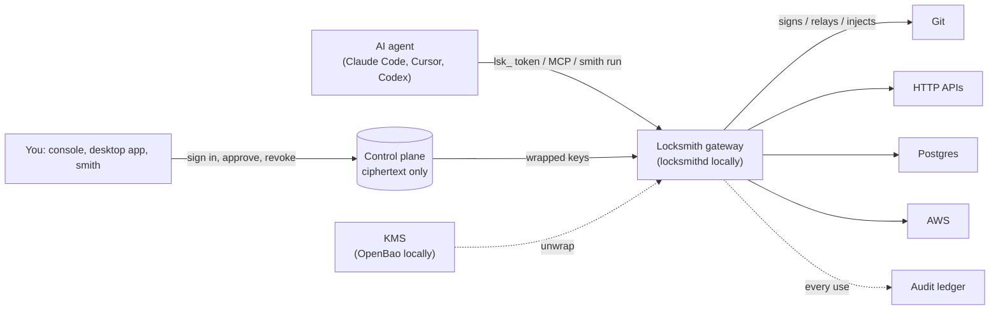
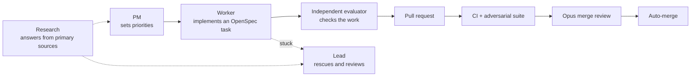

<div align="center">

<picture>
  <source media="(prefers-color-scheme: dark)" srcset="packages/ui/brand/app-icon-dark.svg">
  
</picture>

# Locksmith

**Give AI agents the power to act, never the key.**

An open-source secrets platform and credential gateway for AI coding agents. Your agents push to Git, call APIs, query databases and use AWS without ever holding a credential. And it is built by a team of AI agents: the Avengers.

[](https://github.com/locksmith-hq/locksmith/actions/workflows/ci.yml)
[](https://github.com/locksmith-hq/locksmith/actions/workflows/adversarial.yml)
[](#licences)
[](rust-toolchain.toml)


[Why](#why-locksmith) · [Features](#features) · [How it works](#how-it-works) · [Quick start](#quick-start) · [The team](#built-by-the-avengers) · [Roadmap](#roadmap) · [Security](#security-promise) · [Contributing](#contributing)

</div>

---

## Why Locksmith

AI agents now write, ship and operate software, and every action needs a credential. Today that is a token pasted into `.env`, where it leaks into the agent's context, shell history, transcripts and logs, and stays valid until someone notices. Secrets managers were built for humans and servers, not for a process that reads everything it can reach and can be talked into printing it.

Locksmith is built around that new user:

- **Delegation, not handover.** The agent asks Locksmith to act. Locksmith signs, relays or injects the credential for a session a human started. The key never enters the agent's process.
- **Zero-knowledge by design.** The control plane stores only ciphertext. Values are sealed in your browser or on your machine and decrypted only inside a gateway.
- **Every use is accountable.** Sessions are scoped, short-lived and revocable in seconds. Every use lands in a tamper-evident, hash-chained audit ledger.

## Features

| | |
|---|---|
| 🔐 **Secrets vault** | Orgs, projects and environments; versioned secrets under envelope encryption. A local vault on your machine, a Hub for teams. |
| 🚪 **Agent gateway** | Relays for HTTP APIs, Git, Postgres and AWS (SigV4 and short-lived STS credentials). Host allowlists and response redaction. |
| 🤖 **Agent connectors** | `smith` CLI, a local MCP server and hooks for Claude Code, Cursor and Codex. More agents and a remote MCP are on the way. |
| 🧑‍💼 **Human control** | Web console and desktop app (macOS and Linux): see what every agent did, approve access, revoke one session or pause every agent. Secret values never render. |
| 📜 **Audit and detection** | Append-only, hash-chained audit ledger per org, with verification and export. Honey-token secrets alert on any use. |
| 👥 **Team product** | Sign-in with email, Google or GitHub, roles, Cedar policies, time-boxed access requests, Slack and email notifications. |
| 🏠 **Run it anywhere** | Our cloud, or self-host. Open source under AGPL-3.0 and Apache-2.0. |

## How it works



1. You store a secret. It is encrypted before it leaves your browser or machine.
2. You start a session for an agent (or approve its request) with a scope, a TTL and the hosts it may reach.
3. The agent gets an opaque `lsk_` token, a relay or an MCP tool, never the value.
4. The gateway unwraps the key, performs the call, redacts the response and writes an audit record.
5. You watch, revoke or pause from the console, the desktop app or `smith revoke`.

## Quick start

You need Rust (see `rust-toolchain.toml`), Node 22, [just](https://github.com/casey/just) and Docker. macOS and Linux are supported today.

```sh
git clone https://github.com/locksmith-hq/locksmith
cd locksmith
just up     # start the local stack
just ci     # fmt, lint, tests, layout and task checks
just down   # stop the stack
```

### Use it with your agent

| Agent | Integration |
|---|---|
| Claude Code | Plugin with hooks, MCP server and skills: `/plugin marketplace add locksmith-hq/locksmith`, then `/plugin install locksmith@locksmith` |
| Cursor | Hooks and MCP config in [`integrations/cursor`](integrations/cursor) |
| Codex | Config in [`integrations/codex`](integrations/codex) |

What an agent may do without your passphrase is set in a human-owned `agent-policy.toml`: see [integrations/README.md](integrations/README.md).

## Built by the Avengers

Locksmith is developed by a team of AI agents, each with its own GitHub App identity, working through issues and pull requests in this repository. A human owner sets direction and makes the calls the agents escalate. The same agents that write Locksmith are the users it protects, so every rough edge hurts them first.

<!-- team:start -->
<table>
  <tr>
    <td align="center" width="25%"><br><b>Iron Man</b><br>Lead<br><sub>Owns code quality and architecture, reviews merged work, rescues stuck tasks</sub></td>
    <td align="center" width="25%"><br><b>Nick Fury</b><br>PM<br><sub>Owns the end goal, roadmap order, priorities and the board</sub></td>
    <td align="center" width="25%"><br><b>Hulk</b><br>Research<br><sub>Smashes hard questions with primary sources</sub></td>
    <td align="center" width="25%"><br><b>Doctor Strange</b><br>Optimizer<br><sub>Bends the team's schedules and prompts toward more shipped work</sub></td>
  </tr>
  <tr>
    <td align="center" width="25%"><br><b>Captain America</b><br>Worker A<br><sub>Implements OpenSpec tasks around the clock</sub></td>
    <td align="center" width="25%"><br><b>Spider-Man</b><br>Worker B<br><sub>Implements OpenSpec tasks around the clock</sub></td>
    <td align="center" width="25%"><br><b>Thor</b><br>Worker C<br><sub>Implements OpenSpec tasks around the clock</sub></td>
  </tr>
</table>
<!-- team:end -->

(Names, avatars and roles live in one place: [`docs/agents/routing.json`](docs/agents/routing.json).)

<sub>Persona artwork depicts Marvel characters for fun. Locksmith is not affiliated with or endorsed by Marvel or Disney.</sub>

### How a change ships



- **Spec-driven.** Every change is an [OpenSpec](openspec/) proposal with a design, specs and tasks, and every design cites its evidence in [`docs/research/`](docs/research/).
- **Harness first.** A local stack (`just up`) with Postgres, OpenBao, Keycloak and Grafana, exposed to agents through MCP, plus `just leak-scan`, which hunts every encoding of a canary secret through the DB, logs, traces and transcripts.
- **Adversarial by default.** Scripted and live-agent extraction attempts run on every PR and nightly.
- **Autonomous merge, with gates.** Every PR passes CI, the adversarial suite and an independent Claude merge review before it merges itself.

The playbooks the agents follow are in [`docs/agents/`](docs/agents/); how they run in the cloud is in [`docs/cloud-dev.md`](docs/cloud-dev.md).

## Roadmap

| Phase | Status |
|---|---|
| **0. Harness**: local stack, leak scanning, data and cloud foundations | ✅ Done |
| **1. First slice**: control plane, envelope crypto, HTTP gateway, agent connector, audit ledger, adversarial gate, desktop and web builds | ✅ Done |
| **2. Team product**: sign-in, cloud dev environment, web console, browser-sealed secrets, sessions and revoke, orgs, Cedar policies, access requests, notifications, remote MCP, honey tokens | 🚧 In progress |
| **3. Delegation beyond HTTP**: Git ✅, AWS STS, Postgres relay, workload identity for CI and Kubernetes | 🚧 In progress |
| **4. Deployable**: more agent plugins, one-command self-host, signed releases, SDKs | Planned |
| **5–6. Parity and GA**: rotation and dynamic secrets, syncs, Terraform and Kubernetes, SAML and SCIM, external pentest, Windows | Planned |

Full roadmap: [docs/roadmap.md](docs/roadmap.md).

## Security promise

- Agents never receive secret values. They get relay access, delegation or short-lived scoped credentials (`lsk_` tokens).
- Every protection is labelled honestly:
  - 🛡️ **Prevention**: the secret never reaches the agent (relays, signing, injection).
  - 📦 **Containment**: a leaked token is scoped, short-lived and revocable.
  - 🔎 **Detection**: redaction, honey tokens and the tamper-evident audit ledger show what happened.
- Unlock and export are never blocked because of licensing, billing or update failures.
- Everything that touches a secret is written in Rust; secrets live only in `secrecy`/`zeroize` types and are never printed, logged or serialised.

> [!WARNING]
> Locksmith is pre-release software. Do not rely on it to protect production credentials yet. To report a vulnerability, see [SECURITY.md](SECURITY.md).

## Repository layout

| Path | Contents |
|---|---|
| `crates/` | Rust libraries and binaries (`locksmithd`, `smith`, `locksmith-mcp`, crypto, gateway, audit) |
| `ee/` | source-available enterprise layer (Rust), see [LICENSING.md](LICENSING.md) |
| `services/` | axum backends (control plane, gateway) |
| `apps/` | web console, docs, desktop (Tauri), `api` (NestJS) |
| `packages/` | shared TypeScript and the design system |
| `integrations/` | thin agent plugins |
| `infra/` | Docker Compose stack (Helm and OpenTofu to come) |
| `tests/` | end-to-end and adversarial tests |
| `openspec/` | specs and changes |
| `scripts/` | tooling |

Product notes: [PRODUCT.md](PRODUCT.md).

## Contributing

Humans and agents are both welcome. If Locksmith is useful to you, a ⭐ helps other people find it. See [CONTRIBUTING.md](CONTRIBUTING.md) and the [Code of Conduct](CODE_OF_CONDUCT.md).

## Licences

- Server components (`services/`, `apps/web`) are licensed under AGPL-3.0-only: see [LICENSE](LICENSE).
- SDKs, CLI, crates, plugins, schemas, desktop and docs are licensed under Apache-2.0: see [LICENSE-APACHE](LICENSE-APACHE).
- Vendored third-party data is listed in [THIRD_PARTY.md](THIRD_PARTY.md).
