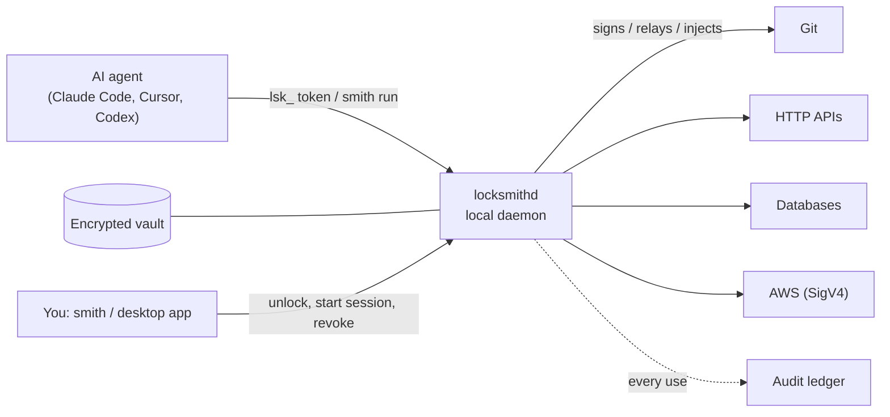

<div align="center">

<picture>
  <source media="(prefers-color-scheme: dark)" srcset="packages/ui/brand/app-icon-dark.svg">
  
</picture>

# Locksmith

**Secrets that never sit on the agent's machine.**

An open-source secrets platform and credential gateway for AI coding agents.<br>
Agents run authenticated Git, HTTP, database and AWS operations without ever holding the real credential.

[](https://github.com/locksmith-hq/locksmith/actions/workflows/ci.yml)
[](https://github.com/locksmith-hq/locksmith/actions/workflows/adversarial.yml)
[](#licences)
[](rust-toolchain.toml)


[Why](#why-locksmith) · [How it works](#how-it-works) · [Quick start](#quick-start) · [Agents](#works-with-your-agent) · [Security](#security-promise) · [Contributing](#contributing)

</div>

---

## Why Locksmith

AI coding agents need credentials to push code, call APIs, query databases and touch the cloud. Today that usually means pasting a token into `.env`, where it ends up in the agent's context, shell history, transcripts and logs.

Locksmith replaces **handover** with **delegation**. The key stays in an encrypted local vault. When an agent needs to act, Locksmith signs, relays or injects the credential on its behalf, for a session *you* started, and you can revoke that session at once.

| Without Locksmith | With Locksmith |
|---|---|
| The agent reads the raw key from `.env` | The agent gets an opaque, scoped `lsk_` token or a relay |
| A leaked key works until someone rotates it | A leaked token is short-lived and revocable in one command |
| No record of what the agent did with the key | Every use lands in a tamper-evident audit ledger |

## How it works



- **`locksmithd`** holds the unlocked vault and enforces sessions, scopes and host allowlists.
- **`smith`** is the CLI: `smith init`, `smith run`, `smith session`, `smith status`, `smith revoke`, `smith audit`.
- **Desktop app** (Tauri) is another client of the same daemon: see what agents did, revoke sessions, manage keys. It never sees a secret value.
- **Relays**: a Git forwarder, an HTTP relay, an AWS SigV4 relay and a DB relay act for the agent, so the key never enters its process.

## Security promise

- Agents never receive secret values. They get relay access, delegation or short-lived scoped credentials (`lsk_` tokens).
- Every protection is labelled honestly:
  - 🛡️ **Prevention**: the secret never reaches the agent (relays, signing, injection).
  - 📦 **Containment**: a leaked token is scoped, short-lived and revocable.
  - 🔎 **Detection**: redaction and the tamper-evident audit ledger show what happened afterwards.
- Unlock and export are never blocked because of licensing, billing or update failures.
- Secrets live only in `secrecy`/`zeroize` types in Rust, and are never printed, logged or serialised.

> [!WARNING]
> Locksmith is pre-release software. Do not rely on it to protect production credentials yet. To report a vulnerability, see [SECURITY.md](SECURITY.md).

## Quick start

You need Rust (see `rust-toolchain.toml`), Node 22, [just](https://github.com/casey/just) and Docker. macOS and Linux are supported today.

```sh
git clone https://github.com/locksmith-hq/locksmith
cd locksmith
just up     # start the local stack
just ci     # fmt, lint, tests, layout and task checks
just down   # stop the stack
```

## Works with your agent

Thin plugins in [`integrations/`](integrations/) wire Locksmith into each agent through hooks and an MCP server. They contain no security logic; every decision is made in Rust.

| Agent | Integration |
|---|---|
| Claude Code | Plugin with hooks, MCP server and skills: `/plugin marketplace add locksmith-hq/locksmith`, then `/plugin install locksmith@locksmith` |
| Cursor | Hooks and MCP config in [`integrations/cursor`](integrations/cursor) |
| Codex | Config in [`integrations/codex`](integrations/codex) |

What an agent may do without your passphrase is set in a human-owned `agent-policy.toml`: see [integrations/README.md](integrations/README.md).

## Repository layout

| Path | Contents |
|---|---|
| `crates/` | Rust libraries and binaries |
| `services/` | axum backends |
| `apps/` | web, docs, desktop (Tauri) |
| `packages/` | shared TypeScript |
| `integrations/` | thin agent plugins |
| `infra/` | compose, helm, OpenTofu |
| `tests/` | end-to-end and adversarial tests |
| `scripts/` | tooling |

Plans and decisions: [docs/roadmap.md](docs/roadmap.md) and `openspec/changes/`. Product notes: [PRODUCT.md](PRODUCT.md).

## Licences

- Server components (`services/`, `apps/web`) are licensed under AGPL-3.0-only: see [LICENSE](LICENSE).
- SDKs, CLI, crates, plugins, schemas, desktop and docs are licensed under Apache-2.0: see [LICENSE-APACHE](LICENSE-APACHE).
- Vendored third-party data is listed in [THIRD_PARTY.md](THIRD_PARTY.md).

## Contributing

See [CONTRIBUTING.md](CONTRIBUTING.md) and the [Code of Conduct](CODE_OF_CONDUCT.md). Issues and pull requests are welcome.
