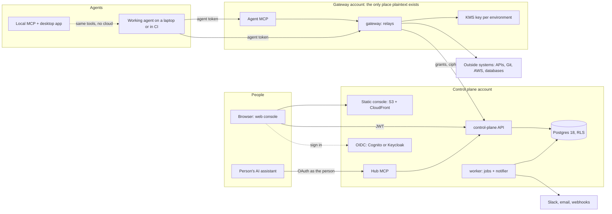

# Locksmith hub: technical design (proposal, 2026-11-19)

Status: **proposal for the owner**. Nothing here is decided. It turns the console mockup
(`apps/web/src/mockup/`, open `apps/web/mockup.html` under `vite`) into an architecture, a data
model, and a set of changes to `docs/roadmap.md` and OpenSpec. Lines marked **Decision needed**
must be approved through a `needs-owner` issue and appended to `openspec/decisions.md` before any
change that depends on them is written.

## 1. What exists and what the mockup asks for

**Built and archived (phase 0 and most of phase 1):**

| Piece | Where | What it does today |
|---|---|---|
| Control plane | `services/control-plane` | REST API for orgs, projects, environments, secrets, secret versions, agents, agent grants, the audit ledger. Postgres 18 with row-level security per org. |
| Envelope encryption | `crates/ls-envelope`, spec `envelope-encryption` | A fresh data key per secret version, wrapped by a KMS key the control plane can use to wrap but not unwrap. |
| Gateway | `services/gateway` | Verifies a 15-minute agent token, checks the grant, unwraps the key, injects the secret into one outbound HTTP call, redacts the response, records it. |
| Agent side | `crates/smith-cli`, `crates/locksmith-mcp`, `integrations/` | CLI and a local MCP server with seven tools; plugins for Claude Code, Codex and Cursor. |
| Audit | `crates/ls-audit`, spec `audit-ledger` | Hash-chained, checkpointed ledger per org with verification. |
| Local stack | `infra/compose`, `just up` | Postgres, OpenBao (stands in for KMS), OTel and Grafana, a mock upstream. |

**Not built:** people. There is no sign-in, no user, no member, no role. The control plane picks
the org from a dev-only header (`services/control-plane/src/auth.rs`). There is no cloud
environment (`infra/` holds only the compose file), no notifications, no remote MCP, no billing,
and the web console is two unstyled pages.

**What the mockup adds:** a hub of six products (Agent Gateway, Secret Management, Certificates,
KMS, Access Broker, Security), workspaces for one person or an organization, projects with their
own members, user management with three fixed roles, integrations, a notification center, three
MCP layers, subscriptions, and settings. A second pass removed every feature that failed a simple
test (section 12), so what remains is meant to be buildable.

The gap is large, and most of it is not on the roadmap. Section 7 says what to do about that.

## 2. Principles this design keeps

These come from `AGENTS.md`, `openspec/config.yaml` and `openspec/decisions.md`. They constrain
every choice below.

1. **Agents never receive a stored secret value.** They get the result of using it.
2. **The control plane never decrypts.** Only a gateway holds plaintext, only in memory.
3. **Postgres is the only required datastore** (A0-1, A0-2). No message broker; background work
   uses a `FOR UPDATE SKIP LOCKED` jobs table.
4. **Every tenant row carries `org_id` under forced row-level security** (A0-4, A0-5), with
   UUIDv7 keys (A0-6) and unique keys that lead with `org_id`.
5. **Services speak generic OIDC only** (A0-15): Cognito in our cloud, Keycloak locally.
6. **Local first** (A0-14): every cloud service has a local stand-in behind a trait.
7. **A billing or licensing failure never blocks unlock or export.**
8. **Thin vertical slices**, each runnable in `just up` the same day.

## 3. Architecture

### 3.1 Components

| Component | New? | Responsibility | Holds plaintext? |
|---|---|---|---|
| **Web console** | Rebuilt | React single-page app, served as static files. Talks only to the control-plane API. Encrypts a secret value in the browser before sending it (section 3.3). | Only while a person types a value |
| **control-plane API** | Exists, grows | All metadata: orgs, users, members, roles, projects, secrets (ciphertext), agents, grants, policies, requests, connections, notification rules, subscriptions. Verifies JWTs from the OIDC issuer. | Never |
| **gateway** | Exists, grows | The data plane. Verifies agent tokens, asks the control plane what is granted, unwraps, relays (HTTP today; Git, AWS, Postgres later), redacts, records. Runs in its own cloud account so a control-plane compromise cannot reach the unwrap key. | Yes, in memory, per request |
| **Hub MCP** | New | A thin MCP server in front of the control-plane API. Signs in as a person. Read tools on by default; tools that change things off by default. | Never |
| **Agent MCP** | New (remote form of `locksmith-mcp`) | A thin MCP server in front of the gateway. Signs in as an enrolled agent. Its tools use keys, they do not return them. | Never returns it |
| **Local MCP** | Exists | `locksmith-mcp` over stdio, talking to the desktop daemon. | Never returns it |
| **worker** | New | One binary, two loops over Postgres tables: scheduled jobs (rotation, sync, scans, renewals, expiry sweeps) and the notifier (outbox to channels). | Never |
| **OIDC issuer** | New (T1) | Cognito in our cloud, Keycloak in `just up`, any issuer for self-hosters. | n/a |

Three services to run in the cloud at first: `control-plane`, `gateway`, `worker`. The two MCP
servers start as routes inside those binaries (`/mcp` on each), not separate deployments, so the
first cloud environment stays at three tasks.

### 3.2 Trust boundaries

- **Browser to control plane:** OIDC access token (JWT), verified through JWKS. The token names the
  user; the org and role come from the `org_members` row, never from the token.
- **Agent to gateway or Agent MCP:** the existing 15-minute EdDSA agent token (audience `gateway`).
- **Gateway to control plane:** today a static bearer token on `/internal/v1`. In the cloud this
  becomes an IAM-signed call or a short-lived service token; a static shared secret across two
  accounts is not acceptable there.
- **Person's assistant to Hub MCP:** OAuth 2.1 with PKCE against the same OIDC issuer, so the
  assistant acts with exactly that person's permissions.

### 3.3 Who can read a secret value

Today a client posts the value over TLS and the control plane seals it, then forgets it. The
roadmap line for the console says "client-side encrypted". To honour that:

- Each environment has a **public** wrapping key published by the control plane; its private half
  lives in KMS and only the gateway role may use it.
- The browser makes a random data key, seals the value with it, and wraps the data key to that
  public key (HPKE). It sends only ciphertext.
- The control plane stores what it received. It never sees the value, even in memory.

The sealing code must be the Rust in `ls-envelope`, compiled to WebAssembly, so there is one
implementation and the "Rust for anything that touches secrets" rule holds in the browser too.

**Decision needed (D-1):** adopt this browser-side sealing scheme. It changes the
`envelope-encryption` spec (the "values are write-only through the API" requirement becomes
"the API accepts only ciphertext"). It needs a short research note with the HPKE crate choice
before the change is proposed.

## 4. Data model

Conventions for every new table, taken from the existing migrations: `id uuid` UUIDv7 primary key,
`org_id uuid NOT NULL`, forced row-level security with the `tenant_isolation` policy, composite
foreign keys that include `org_id`, unique keys that lead with `org_id`, `created_at` and
`updated_at`.

**Exists today (13 tables):** `orgs`, `projects`, `environments`, `secrets`, `secret_versions`,
`agents`, `agent_grants`, `gateway_audit`, `audit_events`, `audit_heads`, `audit_checkpoints`,
`audit_checkpoint_jobs`, `audit_verify_runs`.

### 4.1 Identity and access (needed before anything a person can use)

| Table | Key columns | Notes |
|---|---|---|
| `users` | `id`, `issuer`, `subject`, `email`, `name` | One row per person, global (no `org_id`; the one exception to the tenant rule, guarded by its own policy). Unique on (`issuer`, `subject`). |
| `org_members` | `org_id`, `user_id`, `role`, `status` | The link that gives a user an org. `status`: invited, active. |
| `invitations` | `org_id`, `email`, `role`, `token_hash`, `expires_at` | Token stored hashed, like the agent enrollment secret. |
| `groups`, `group_members` | `org_id`, `name`; `group_id`, `user_id` | Teams. |
| `org_members.role` | enum: owner, admin, member | Three fixed roles. No roles table and no custom roles in the first version; what each may do is code, shown read-only in the console. |
| `project_members` | `org_id`, `project_id`, `principal_kind` (user or group), `principal_id`, `role` (admin, developer, viewer) | Who can open a project. Org owners and admins are implied, not stored. |
| `orgs` (changed) | add `kind` (personal or organization), `slug`, `owner_user_id` | A personal workspace is an org with one member. |

### 4.2 Agent Gateway

| Table | Key columns | Notes |
|---|---|---|
| `agent_tokens` | `org_id`, `agent_id`, `jti`, `issued_at`, `expires_at`, `revoked_at` | Makes "live sessions" listable and revocable. The gateway checks a small revocation set; the token itself stays stateless. |
| `secret_hosts` | `org_id`, `secret_id`, `host` | The allow-list: a secret is only injected into calls to these hosts. Today this rule lives in gateway config. |
| `org_guardrails` | `org_id`, `production_needs_approval`, `max_grant_seconds`, `default_grant_seconds`, `tell_admin_on_blocked_host` | Three plain settings in place of a rule builder. Checked in the control plane when a grant is made. A general policy engine (T2) can replace this row later without changing the console. |
| `access_requests` | `org_id`, `requester_kind`, `requester_id`, `secret_id`, `duration`, `reason`, `status`, `decided_by`, `decided_at`, `comment` | The approvals queue (roadmap T4). Approving inserts the `agent_grants` row in the same transaction. |
| `org_controls` | `org_id`, `agents_paused_at`, `paused_by` | The pause switch. The gateway refuses every token while set. |
| `agent_grants` (changed) | add `granted_by`, `last_used_at`; extend `mode` | `mode` gains values as relays arrive (git, aws, db). |

### 4.3 Secret Management extras (roadmap phase 5: "rotation, dynamic secrets, syncs")

`connections` (shared integrations: kind, provider, scope, a reference to the secret that holds its
own credential), `rotation_rules`, `sync_targets`, `dynamic_secret_defs` and `leases`,
`share_links` (ciphertext, expiry, view count; the key never reaches the server), `machines` (CI
and workload identities, roadmap D4).

### 4.4 Platform

| Table | Key columns | Notes |
|---|---|---|
| `events_outbox` | `org_id`, `seq`, `kind`, `payload jsonb`, `created_at`, `dispatched_at` | Written in the same transaction as the change it describes. The single source for notifications, webhooks and usage counters. Payloads carry names and ids, never values. |
| `jobs` | `org_id`, `kind`, `run_at`, `attempts`, `locked_until`, `payload jsonb` | The A0-2 jobs table. Generalizes `audit_checkpoint_jobs`. |
| `notification_channels` | `org_id`, `kind` (inbox, slack, email, webhook), `connection_id`, `status` | |
| `notification_rules` | `org_id`, `event_kind`, `channel_id`, `audience`, `enabled` | The matrix. |
| `notifications` | `org_id`, `user_id`, `event_seq`, `level`, `read_at` | The in-app inbox, one row per recipient. |
| `notification_deliveries` | `notification_id`, `channel_id`, `status`, `attempts`, `last_error` | Idempotent on (`event_seq`, `channel_id`, `recipient`). |
| `mcp_clients` | `org_id`, `layer` (hub, agent), `principal_kind`, `principal_id`, `client_name`, `connected_at`, `last_call_at`, `revoked_at` | The Clients page. |
| `mcp_tool_settings` | `org_id`, `layer`, `tool`, `enabled` | One switch per tool. Which agents may connect is a column on `agents`. |
| `subscriptions` | `org_id`, `plan`, `seats`, `period`, `status`, `provider_ref`, `renews_at` | One per org. |
| `usage_counters` | `org_id`, `period`, `kind`, `count` | Fed from the outbox. |

MCP calls are **not** a new log table: each call is an audit event in the existing ledger with the
tool name and the target by name. One history, one place to verify.

### 4.5 Later products

Certificates (`authorities`, `certificate_profiles`, `certificates`), KMS (`kms_keys`,
`kms_key_versions`, `kms_clients`, `kms_permissions`), Access Broker (`resources`,
`resource_accounts`, `broker_sessions`, `recordings`), Security (`scan_sources`, `scan_rules`,
`findings`). Shape only; no column design until each has a research note and an owner decision
(section 7).

## 5. Notifications

1. A change and its `events_outbox` row commit together.
2. The worker reads new outbox rows in order, per org.
3. For each event it reads `notification_rules`, works out the audience (owners and admins,
   project admins, the person involved, everyone) and writes `notifications` rows (the inbox)
   plus one `notification_deliveries` row per outside channel.
4. Channel adapters send: Slack (incoming webhook first, an app later), email (SES in the cloud,
   Mailpit locally), and a signed generic webhook.
5. Failures retry with backoff through the `jobs` table; a channel that keeps failing is marked
   "needs attention" and its owners are told through the inbox.

The inbox channel always exists and cannot be switched off, so there is always one place where nothing
is lost. No notification payload ever contains a secret value.

## 6. MCP

Three layers, as in the mockup. They differ in who signs in and in risk, so they are separate
servers with separate tool lists.

| | Hub MCP | Agent MCP | Local MCP |
|---|---|---|---|
| Signs in as | A person (OAuth 2.1 + PKCE against the OIDC issuer) | An enrolled agent (agent token) | The local user (attested daemon client) |
| Runs | Control-plane account, route `/mcp` on the API | Gateway account, route `/mcp` on the gateway | The developer's machine, stdio |
| Transport | Streamable HTTP | Streamable HTTP | stdio |
| For | A person's assistant reading and managing the hub | A working agent doing its job | One developer without the cloud |
| Tools, on by default | list projects, list secret names, read activity, list findings, list waiting requests, explain a block | list my keys, start session, relay an HTTP request, request access, explain a block | the seven tools that exist today |
| Tools, off by default | approve or deny a request, revoke a grant, rotate a secret, pause agents | issue a short-lived credential | none |
| Can return a stored secret value | No | No | No |

**The rule, and the one exception.** No MCP tool returns a stored secret value: the agent gets the
response of the call the gateway made with the key. Some tools cannot work that way (a database
driver or cloud SDK that insists on holding a credential). For those the Agent MCP may offer
`issue_short_lived_credential`: a credential the gateway creates on demand, valid for minutes,
scoped to one job, and destroyed after. It is one switch for the workspace, off by default, and
every issue is an audit event. This matches the security rule in `AGENTS.md`: "relay, delegation, or
short-lived scoped credentials".

**Decision needed (D-2):** confirm that rule, including the exception. The request that prompted
this design said working agents should "get access to key values"; under D-2 they get the use of a
key, or a short-lived scoped credential, and never the stored value.

Every tool call passes through the same policy check as a console action and lands in the audit
ledger. Tool switches (`mcp_tool_settings`) are enforced server-side; a client cannot list or call
a tool that is off.

## 7. Roadmap and OpenSpec: what to change

### 7.1 The problem with the current order

`docs/roadmap.md` after the two changes in flight (S6, X1) runs: T1 human auth, T6 members, T2
policy engine, T3 console, T4 access requests, T5 honey tokens, then D1 to D4, and only then P1,
the first cloud environment. That is eleven changes before anything runs outside a laptop, and the
console arrives fourth.

Two things follow. Nobody can use the product until late, and every change before P1 is built
without learning what the cloud forces on it (cross-account gateway trust, cold starts on an
auto-paused database, real OIDC redirects).

### 7.2 Proposed order: reach "a person uses it in the cloud" first

**Decision needed (D-3):** move the cloud environment ahead of the team features, and split the
console into slices that land with the features they show.

| # | Change | Usable outcome | Why here |
|---|---|---|---|
| 1 | `s6-adversarial-gate-1`, `x1-apps-all-platforms` | As written. | Already in flight. |
| 2 | `t1-human-auth` | Sign up and sign in; a personal org is created; the API verifies JWTs. | Nothing can be exposed to the internet while the org comes from a dev header. |
| 3 | `p1-aws-dev-env` (moved up, narrowed) | `control-plane`, `gateway` and Postgres run in the AWS dev account behind Cognito; `just aws-up` and `just aws-down`. | The earliest point at which the cloud is safe to open. Still inside the A0-16 budget. |
| 4 | `t3a-console-shell` (new, replaces the start of T3) | The mockup's shell on the real API: hub home, projects, environments, secret names and versions, agents, grants, activity. Design tokens move to `packages/ui`. | First thing a person can click in the cloud. Read and manage; no value entry yet. |
| 5 | `t3b-secret-write` (new) | Add a secret or a new version from the browser, sealed in the browser (D-1). | Needs the WebAssembly build and the spec change; kept apart so it gets its own security review. |
| 6 | `t3c-sessions-and-revoke` (new) | Live sessions listed, revoke one, revoke all, pause agents (`agent_tokens`, `org_controls`). | Completes "see and stop anything at once", the product's promise. |
| 7 | `t6-org-members` | As written, plus project members and the built-in roles. | Teams. |
| 8 | `t2-policy-engine` | Narrowed to start: the three guardrails (`org_guardrails`) enforced when a grant is made. A general engine only when a customer needs a rule those three cannot express. | |
| 9 | `t4-access-proposals` | As written; the Approvals queue. | |
| 10 | `n1-notifications` (new) | Outbox, inbox, Slack and email, the rules matrix. | Approvals without notifications are a queue nobody watches. |
| 11 | `m1-remote-mcp` (new) | Hub MCP and Agent MCP over HTTP, tool switches, the Clients and Activity pages. | Builds on auth, policies and the gateway. |
| 12 | `t5-honey-tokens`, then D1 to D4 | As written. | |

After step 6 the product does a real job in the cloud for one person: sign in, create a project,
add a secret, enroll an agent on a laptop, let Claude Code call a real API through the cloud
gateway, watch the session in the console, revoke it and see the agent blocked. That is the demo
to aim at. Step 10 adds "and Slack tells you".

### 7.3 Changes to existing OpenSpec material

- **`docs/roadmap.md`:** reorder as above; split the T3 row into T3a, T3b, T3c; add N1 and M1 rows;
  move P1 to phase 2. Roadmap rows generate the GitHub issues, so issues 90 (T3) and 97 (P1) change
  with it.
- **`openspec/specs/envelope-encryption`:** modified by `t3b-secret-write` (D-1).
- **`openspec/specs/agent-connector`:** `t3c` adds revocation and pause; `m1` adds the remote MCP
  requirements.
- **`openspec/specs/control-plane-api`:** every change above adds routes; the dev-header
  requirement is removed by T1.
- **New capability specs:** `human-auth` (T1), `org-membership` (T6), `access-policy` (T2),
  `console` (T3a onward), `notifications` (N1), `remote-mcp` (M1), `cloud-dev-environment` (P1).
- **`DESIGN.md`:** it still describes the older "Keying Schedule" look. `t3a` should replace it
  with the shipped "Gatehouse" system plus the console additions, generated from the built result.
- **`PRODUCT.md`:** add the web console as a surface and the hub as the product shape, after D-4.

Each of these is a normal `/opsx:propose` change. I have not created them: the roadmap and the
decisions file are the owner's to change.

### 7.4 The four products that are not on the roadmap

Certificates, KMS, Access Broker and Security appear in the mockup because the brief was to match
a competitor's line-up. None has a roadmap row, a research note or a decision.

**Decision needed (D-4):** whether Locksmith becomes a hub of products at all, and in what order.
My recommendation: keep them in the mockup as direction, add one "Phase 7: product expansion"
section to the roadmap that lists them without dates, and do not write a spec for any of them
until Agent Gateway and Secret Management are in use in the cloud. Each is a product-sized effort
(a certificate authority and a session-recording broker are not features), and the evidence rule
in `openspec/config.yaml` requires a research note per product first. `docs/research/infisical.md`
covers the competitor but not how we would build any of these.

Billing ("subscriptions and plans") is already named in phase 5. It should stay late: it needs a
payment-provider decision, and principle 7 above means it must be built so that it can never gate
unlock or export.

## 8. Running in the cloud

Follows A0-12, A0-13, A0-16, A0-17.

- **Accounts:** `control-plane-dev` and `gateway-dev`. The unwrap permission on the KMS key exists
  only in `gateway-dev`.
- **Compute:** ECS Fargate, ARM, three small tasks (`control-plane`, `gateway`, `worker`) that
  exist only during a test session (`just aws-up`, auto-destroyed).
- **Data:** Aurora Serverless v2 with auto-pause. Migrations run as the owner role in a one-off
  task; services connect as the app role.
- **Sign-in:** a Cognito user pool. Services only verify JWTs.
- **Console:** static files in S3 behind CloudFront. No server-side rendering, so no fourth task.
- **Email:** SES in the cloud, Mailpit in `just up`.
- **Checkpoints:** S3 Object Lock, as the audit-ledger spec already requires.

Two constraints in the decisions file conflict with a normal public deployment, and P1 has to
resolve them:

1. **A0-16 bans an ALB and a NAT gateway in dev.** Fargate tasks then need public IPs and
   something else in front for TLS and a stable name. Options are CloudFront in front of the
   tasks, or API Gateway HTTP API with a VPC link. P1 must pick one from a cost comparison.
2. **CI may not build or deploy** (`AGENTS.md`: no build or Docker jobs in workflows). Images
   therefore have to be built in the agent VM or locally and pushed, with OpenTofu applied from
   the manual workflow P1 already describes. That is workable for dev; it will need revisiting
   for a production environment.

**Decision needed (D-5):** accept a dev environment that exists only during sessions as the first
"works in the cloud" milestone, or raise the dev budget so one always-on environment can serve as
a demo. The current $5 a month cap does not allow always-on.

## 9. From mockup to product code

- The mockup is throwaway and stays out of the build. It is the reference for `t3a`.
- `t3a` moves the Gatehouse tokens and the shared components into `packages/ui`, so the desktop
  app and the console use one source.
- Each real page replaces its sample store with calls through `packages/control-plane-client`,
  generated from `openapi.json`. The mockup's stores already separate data from pages, which makes
  the swap mechanical page by page.
- Playwright end-to-end tests, as the T3 row requires, run in the agent VM against `just up`.
- Pages for features that do not exist yet are not shipped as placeholders. A product appears in
  the real hub only when its first page works.

## 10. Risks and open questions

- **Scope.** The mockup is several times the size of the roadmap. Without D-4 the plan has no
  boundary.
- **Browser-side sealing (D-1)** adds a WebAssembly build and a new key-distribution path. It is
  the most security-sensitive item here and should be an `[opus]` change with its own adversarial
  cases.
- **Gateway-to-control-plane trust** across accounts is undesigned. It must be settled in P1, not
  patched later.
- **Remote MCP sign-in.** The MCP authorization flow for remote servers needs a research note
  (client registration, token audience, how each agent tool stores a token) before M1 is proposed.
  I have not verified current client support and treat it as unknown.
- **Revocation latency.** Agent tokens live 15 minutes and the gateway caches grants. "Revoke" and
  "pause" must take effect in seconds, which means a revocation check on every request. P1 load
  numbers should confirm the cost.
- **Policy engine choice.** T2 names Cedar. The mockup now shows only three fixed guardrails,
  which need no engine. T2's design should say whether Cedar is still wanted for the first
  version or deferred.

## 11. Getting data out

Principle 7 requires that export always works. A server-side "export everything" cannot exist,
because the control plane cannot decrypt. Export is therefore a CLI command an owner runs on their
own machine, one project and environment at a time: `smith export <project> --env <env> --out
<file>`. The CLI authenticates as the person, the gateway checks the owner role, unwraps and
streams the values to that one caller, and the run is an audit event. The console's Settings page
shows the command and says who may run it. This is the only path by which a person reads stored
values back, and it needs its own adversarial cases.

## 12. What was cut from the mockup, and the test used

Every feature had to pass three questions: would a developer running agents, or the person who
reviews access, use it at least monthly or need it to stop an incident; can we say in one
sentence how to build it; and is it missing from every other page. A setting with an obvious
right default is not a setting.

| Cut | Why | What does the job now |
|---|---|---|
| "Export everything" button | The server cannot decrypt, so it cannot be built as shown. | The CLI export in section 11. |
| Policies page: ordered rules, sentence builder, request tester | An engine and a rule language nobody asked for. | Three guardrails on the Agent Gateway Settings page. |
| Custom roles (organization and project) and their matrices | Small teams need three roles; custom roles are an enterprise request. | Fixed roles, shown read-only. |
| Project Insights | Repeated the Overview's "needs attention" list. | Secret Management Overview. |
| Project templates | No user asked to stamp out projects. | Nothing. |
| Webhooks on secret changes | Syncs already push changes where they are needed. | Syncs; the generic notification webhook. |
| Certificates expiry-alert rules | A second notification system. | One rule in the Notification center. |
| KMS "Try it" panel | A demo, not a task; people test from their code. | Nothing. |
| Notification preferences, snooze, quiet hours, digest, Teams, PagerDuty | Configuration without a user asking for it. | Inbox, Slack, email, webhook, one rules matrix. |
| MCP activity log and per-agent tool lists | Duplicated product Activity and grants. | One switch per tool; calls appear in each product's Activity. |
| Security: custom patterns, comments, bulk actions, per-rule pages | First version ships built-in detectors and ignored paths. | Findings, sources, detectors. |
| Sign-in: passkeys, forced single sign-on, sign-out timer | Not in T1; passkeys were moved out of it. | Email, Google, GitHub, a second step. |
| Detail pages that only repeated their row | No new information. | The list row. |

## 13. Decisions requested

| # | Decision | Recommendation |
|---|---|---|
| D-1 | Seal secret values in the browser (HPKE to a per-environment key; Rust compiled to WebAssembly) | Yes |
| D-2 | No MCP tool returns a stored secret value; the only credential an agent may hold is a short-lived, scoped one, off by default | Yes |
| D-3 | Reorder the roadmap: T1, then P1, then the console in three slices, then teams, policy, approvals, notifications, remote MCP | Yes |
| D-4 | Treat Certificates, KMS, Access Broker and Security as later direction, not committed work | Yes |
| D-5 | First cloud milestone is a session-only dev environment within the current budget | Yes, revisit once there is something to demo |
